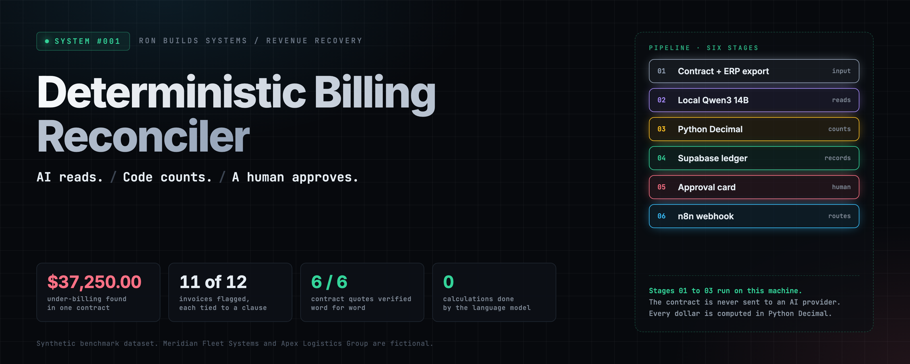
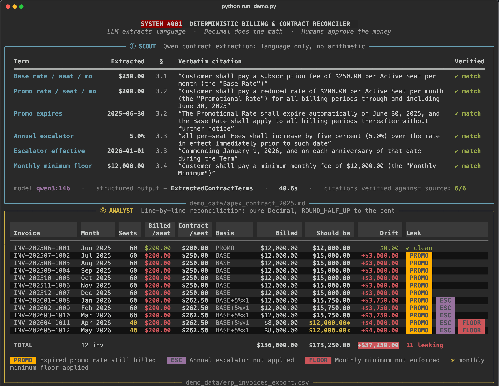
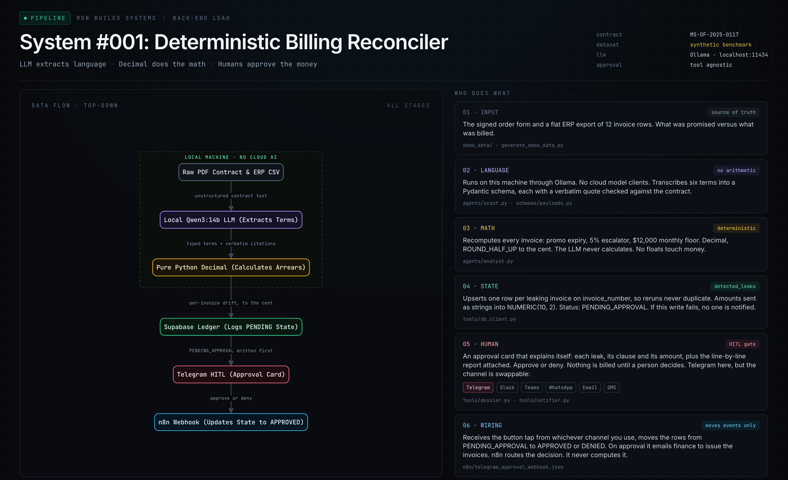
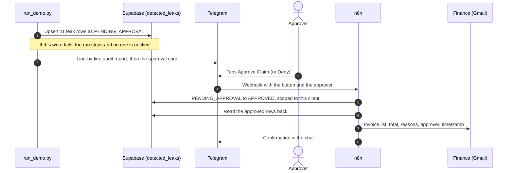
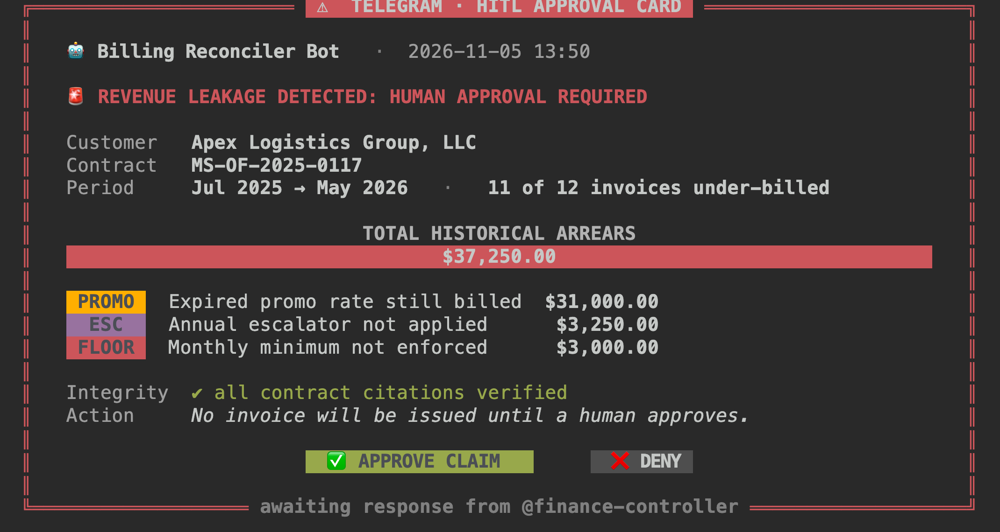
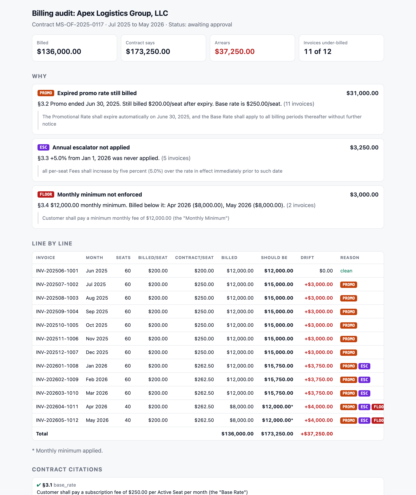
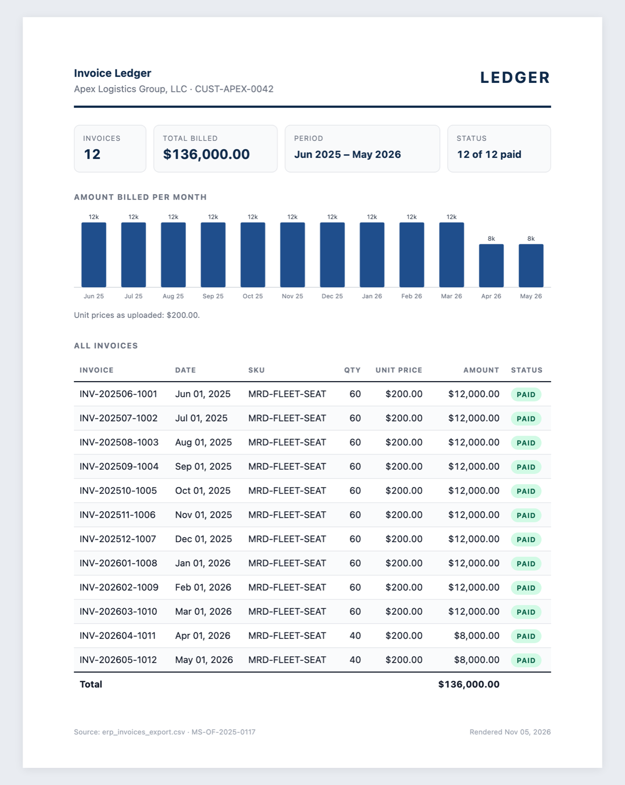
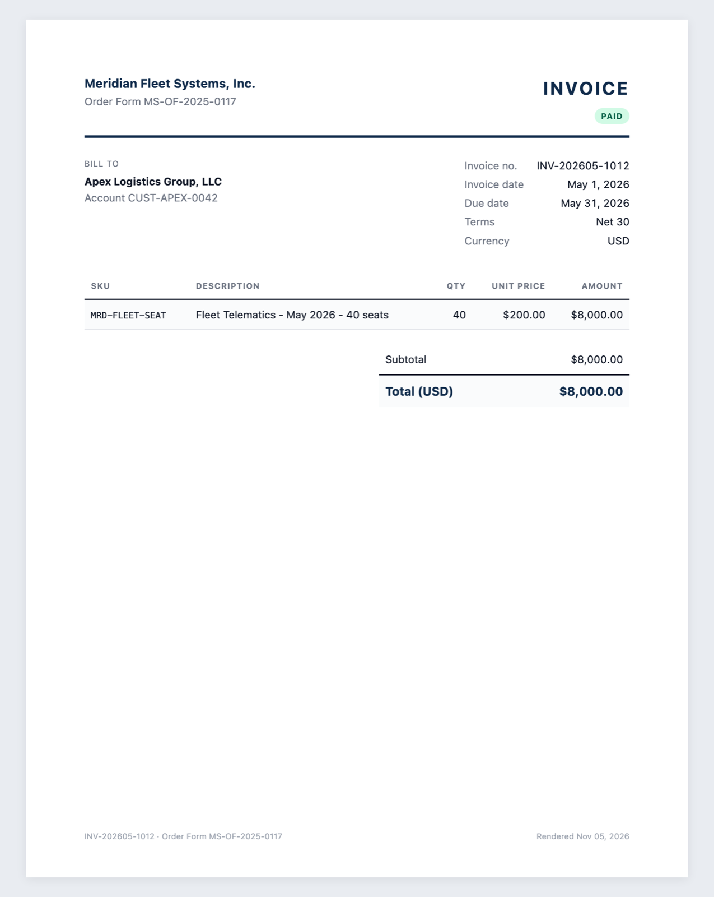
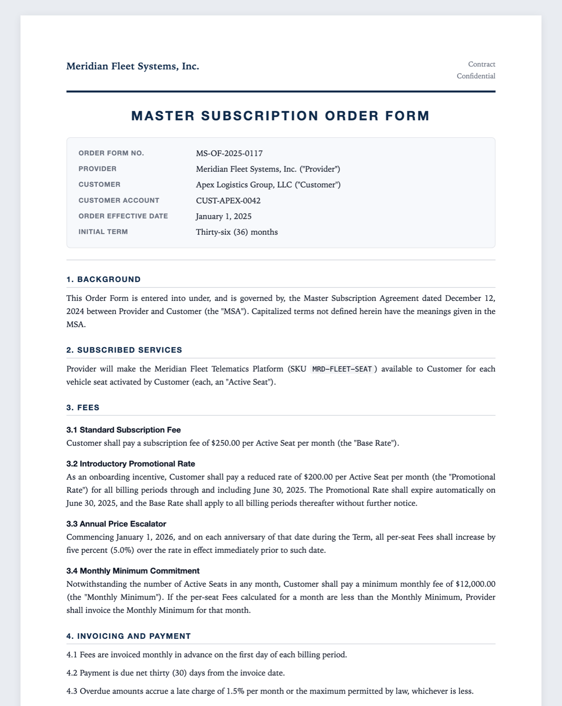

<p align="center">
  
</p>

<p align="center">
  
  
  
  
  
  
  
</p>
<p align="center">
  
  
  
  
</p>

<p align="center">
  <a href="#the-37250-problem">The problem</a> ·
  <a href="#see-it-run">See it run</a> ·
  <a href="#architecture">Architecture</a> ·
  <a href="#the-guarantees">Guarantees</a> ·
  <a href="#what-the-approver-sees">Approver view</a> ·
  <a href="#client-ready-pdfs">Client PDFs</a> ·
  <a href="#quickstart">Quickstart</a> ·
  <a href="#repository-map">Repo map</a> ·
  <a href="#where-the-data-goes">Data handling</a>
</p>

---

**System #001 finds revenue that signed contracts promised and billing never collected.** A local language model reads the contract and transcribes its pricing terms, with a verbatim quote for every term. Pure Python recomputes every invoice to the cent. Every finding is written to a ledger, explained in plain English, and held there until a person taps **Approve** or **Deny**. Nothing is billed without that tap.

> [!IMPORTANT]
> **Two rules this system is built on.** The language model never does math: it reads, and code counts. The contract is never sent to an AI provider: extraction runs on your own machine through Ollama.

<br>

## The $37,250 problem

The demo account is a 36-month seat subscription. The order form has four pricing clauses. Billing honoured one of them.

| Clause | What the contract says | What billing did | Leaked |
|:--|:--|:--|--:|
| **§3.2 Promo expiry** | $200/seat through June 30, 2025, then $250 base rate | Kept billing $200/seat for 11 more months | **$31,000.00** |
| **§3.3 Escalator** | +5.0% on every per-seat fee from January 1, 2026 | Never applied | **$3,250.00** |
| **§3.4 Monthly minimum** | $12,000.00 floor, regardless of seat count | Billed $8,000.00 when seats dropped to 40 | **$3,000.00** |
| | | **11 of 12 invoices under-billed** | **$37,250.00** |

Billed: **$136,000.00**. Contract says: **$173,250.00**. Nobody noticed, because the person who signs the contract is not the person who bills it, and six months later nobody's job is to reopen it.

<sub>Synthetic benchmark dataset. Meridian Fleet Systems and Apex Logistics Group are fictional. The leaks are planted by <code>generate_demo_data.py</code> so the result is reproducible.</sub>

<br>

## See it run

One command. A real run on the demo data: Qwen3 14B reads the contract locally in about 40 seconds, all six contract quotes verify against the source, and the Analyst reconciles all twelve invoices.

```bash
python run_demo.py
```

<p align="center">
  
</p>

<br>

## Architecture

Six stages, each owned by one file. Everything inside the dashed box runs on the local machine.

<p align="center">
  
</p>

| # | Stage | What happens | Owned by |
|:-:|:--|:--|:--|
| 01 | **Input** | The signed order form and a flat ERP export. What was promised versus what was billed. | `demo_data/` · `generate_demo_data.py` |
| 02 | **Language** | Qwen3 14B, local through Ollama, fills a strict Pydantic schema: six pricing terms, each with a verbatim quote. Temperature 0. No arithmetic. | `agents/scout.py` · `schemas/payloads.py` |
| 03 | **Math** | Every invoice recomputed in `Decimal`, `ROUND_HALF_UP` to the cent. Every dollar of drift attributed to a clause. | `agents/analyst.py` |
| 04 | **State** | One row per leaking invoice in `detected_leaks`, status `PENDING_APPROVAL`, with the clause and a plain-English description. | `tools/db_client.py` |
| 05 | **Human** | An approval card that explains itself, with the full line-by-line audit attached. | `tools/dossier.py` · `tools/notifier.py` |
| 06 | **Wiring** | n8n catches the button tap, moves the rows to `APPROVED` or `DENIED`, and on approval emails finance. It routes. It never computes. | `n8n/telegram_approval_webhook.json` |

### The approval loop



### The math, in full

```text
For an invoice dated D with quantity Q:

  1. rate      = promo_rate if D <= promo_expiration_date else base_rate
  2. rate      = rate x (1 + escalator%) for each escalation date <= D
                 (compounded, rounded to the cent at each step)
  3. usage     = rate x Q
  4. expected  = max(usage, monthly_minimum_floor)
     drift     = expected - billed            (positive = under-billed)
```

Drift is then split into reasons in clause order: promo, escalator, floor. If the reasons do not add up to the total drift **to the cent**, the Analyst raises `ArithmeticError` and the run stops. It refuses to report a number it cannot explain.

<br>

## The guarantees

These are enforced in code, not left to convention. They are also written into [`CLAUDE.md`](CLAUDE.md), so a coding agent working in this repo cannot drift from them.

<table>
<tr>
<td width="50%" valign="top">

**The model only reads**<br>
<sub>The Scout's system prompt forbids calculating, inferring, rounding or combining numbers. Money and percentages cross the model boundary as strings and are parsed into <code>Decimal</code> on the Python side. A float never touches a dollar.</sub>

</td>
<td width="50%" valign="top">

**Every term must be quoted**<br>
<sub>Each extracted term comes with a quote from the contract. Each quote is checked against the source text (ignoring only case, whitespace and markdown emphasis). A made-up clause shows up as <code>NOT FOUND</code>, in red.</sub>

</td>
</tr>
<tr>
<td valign="top">

**The math must reconcile**<br>
<sub>Per-reason amounts must sum exactly to each invoice's drift. If they do not, the run stops with <code>ArithmeticError</code>.</sub>

</td>
<td valign="top">

**Record before you ask**<br>
<sub>Leaks are written to <code>detected_leaks</code> before any notification is sent. If the ledger write fails, the approval card is never sent. No one is asked to approve money that is not on the record.</sub>

</td>
</tr>
<tr>
<td valign="top">

**Reruns are safe**<br>
<sub>Rows are upserted on <code>invoice_number</code>, so a hundred reruns never create a duplicate. Status is never sent on upsert, so a rerun never undoes a decision a human already made.</sub>

</td>
<td valign="top">

**A person makes the call**<br>
<sub>Nothing is billed until someone taps Approve. Deny really denies. Updates are scoped to the client on the card, and the approver's name goes into the finance email.</sub>

</td>
</tr>
</table>

<br>

## What the approver sees

The approval card leads with the total and breaks it down by reason. The full audit report is attached to the same chat, so the approver can check every line on their phone before deciding.

<table>
<tr>
<td width="50%" valign="top"></td>
<td width="50%" valign="top"></td>
</tr>
<tr>
<td align="center"><sub>The card (terminal preview of the Telegram message)</sub></td>
<td align="center"><sub>The attached line-by-line audit report</sub></td>
</tr>
</table>

Every row in the ledger also carries a `leak_description`, generated in Python from the audit results, so anyone opening the table knows what happened to that invoice without opening the report:

> **Apr 2026:** billed $8,000.00 for 40 seats at $200.00/seat, but the contract requires $12,000.00 (the monthly minimum; 40 seats at $262.50 only come to $10,500.00). Under-billed by $4,000.00. Expired promo rate still billed: $2,000.00 (promo ended Jun 30, 2025; base rate is $250.00/seat). Annual escalator not applied: $500.00 (+5.0% from Jan 1, 2026 raises the rate to $262.50/seat). Monthly minimum not enforced: $1,500.00 ($12,000.00 monthly minimum).

<br>

## Client-ready PDFs

Drop a client's invoice CSV or contract into `client_inbox/` and a formatted PDF appears in `client_inbox/rendered/` a few seconds later. Rendering is local, through headless Chrome or Microsoft Edge.

<table>
<tr>
<td width="33%"></td>
<td width="33%"></td>
<td width="33%"></td>
</tr>
<tr>
<td align="center"><sub>Ledger with a monthly chart</sub></td>
<td align="center"><sub>One page per invoice</sub></td>
<td align="center"><sub>The contract, typeset</sub></td>
</tr>
</table>

```bash
python tools/render_pdfs.py                  # render anything new or changed, then exit
python tools/render_pdfs.py --watch          # keep running, render files as they land
python tools/render_pdfs.py --install-agent  # start the watcher at login (macOS and Windows)
```

- **Invoice CSVs** become a ledger page plus one page per invoice. Column names are matched loosely, and US dates, `$1,234.00` amounts and `(500.00)` negatives are understood.
- **Contracts** (`.md`, `.txt`) become a typeset PDF. When a contract sits next to a CSV for the same customer, the invoices pick up the provider name, order number and payment terms from it.
- **Anything else** still renders, as a clean table with a note explaining why. One bad file never stops the watcher.
- Only changed files are re-rendered. Values are shown exactly as uploaded, never corrected.

<br>

## Quickstart

### 1. Prerequisites

| Need | Why |
|:--|:--|
| Python 3.12 | Runtime |
| [Ollama](https://ollama.com) with `qwen3:14b` | Local contract extraction (about 9 GB) |
| A Supabase project | The `detected_leaks` ledger |
| A Telegram bot | The approval card |
| n8n (Cloud or self-hosted with a public URL) | Receives the button tap |
| Chrome or Edge | Optional, for PDF rendering |

### 2. Install

```bash
git clone https://github.com/ronfarley0317/system-001-billing-reconciler.git
cd system-001-billing-reconciler
python -m venv .venv
source .venv/bin/activate          # Windows: .venv\Scripts\activate
pip install -r requirements.txt
ollama pull qwen3:14b
cp .env.example .env               # Windows: copy .env.example .env
```

### 3. Configure `.env`

| Variable | Purpose |
|:--|:--|
| `OLLAMA_BASE_URL` | Local model endpoint. Default `http://localhost:11434/v1` |
| `OLLAMA_MODEL` | Default `qwen3:14b` |
| `TELEGRAM_BOT_TOKEN` | From @BotFather. Message your bot once before the first run |
| `TELEGRAM_CHAT_ID` | The chat that receives the approval card |
| `SUPABASE_URL` | Your project URL |
| `SUPABASE_SERVICE_ROLE_KEY` | Server-side key. Never commit it; `.env` is git-ignored |

### 4. Create the ledger

In the Supabase SQL editor, run [`sql/001_create_detected_leaks.sql`](sql/001_create_detected_leaks.sql), then [`sql/002_add_leak_description.sql`](sql/002_add_leak_description.sql).

### 5. Wire the approval

Import [`n8n/telegram_approval_webhook.json`](n8n/telegram_approval_webhook.json) into n8n. Replace each `REPLACE_WITH_...` credential and the finance email address, then switch the workflow to **Active**.

### 6. Run

```bash
python run_demo.py                 # full run: extract, reconcile, record, send the approval card
python run_demo.py --no-telegram   # everything except the Telegram message
python generate_demo_data.py       # rebuild the demo contract and ERP export
```

### 7. Run on your own data

Each run takes one contract and one invoice export for one customer.

```bash
python run_demo.py --client companyx                                        # reads clients/companyx/
python run_demo.py --contract path/to/contract.md --invoices path/to/export.csv
```

With `--client`, put two files in `clients/<name>/`: `contract.md` (or `contract.txt`) and `invoices.csv`. The `clients/` folder is git-ignored, so client data is never committed.

| Input | Requirements |
|---|---|
| Contract | Plain text or Markdown. Convert a PDF to text first (`pdftotext`, or OCR for a scan). Citations are verified word for word against this file. |
| Invoice CSV | Columns `invoice_id`, `invoice_date` (`YYYY-MM-DD`), `quantity`, `unit_price`, `amount_billed` (plain numbers, no `$` or commas). `customer_name` is optional. |

> [!TIP]
> Before each recording take or demo, reset the rows to `PENDING_APPROVAL`. The approve step only updates pending rows.

<br>

## Repository map

```text
system-001-billing-reconciler/
├── run_demo.py                     Conductor: read, reconcile, record, then ask a human
├── CLAUDE.md                       The rulebook: local AI only, Decimal only, ledger first
├── agents/
│   ├── scout.py                    Local Qwen extraction plus word-for-word citation checks
│   └── analyst.py                  Decimal reconciliation and per-clause leak attribution
├── schemas/
│   └── payloads.py                 The form the model must fill: six terms, each quoted
├── tools/
│   ├── db_client.py                Idempotent upsert into detected_leaks
│   ├── dossier.py                  Approval card, audit report and leak descriptions
│   ├── notifier.py                 Telegram delivery: report first, then the card
│   └── render_pdfs.py              Client uploads to PDF, with a folder watcher
├── n8n/
│   └── telegram_approval_webhook.json   Approve / deny routing and the finance email
├── sql/                            Ledger schema for a fresh Supabase project
├── demo_data/                      Synthetic contract, ERP export, rendered PDFs
├── generate_demo_data.py           Builds the demo with three planted leaks
└── docs/assets/                    Images used in this README
```

Each file has exactly one job. When something breaks, you know where to look. The approval channel lives in one file: swap `tools/notifier.py` for Slack, Teams, WhatsApp Business or email and nothing upstream changes.

<br>

## Where the data goes

| Data | Where it goes | Why |
|:--|:--|:--|
| Full contract text | **Stays on this machine.** Read by Ollama on `localhost` | Extraction only |
| Extracted terms and all calculations | **Stays on this machine** | Python `Decimal` |
| Each finding: client, invoice, amount, clause quote, description | Your Supabase project | The system of record |
| Approval card and the attached audit report (includes contract quotes) | The Telegram chat you configure | The human decision |
| Approved invoice list, total, reasons, approver | Finance, by email through n8n | The handoff |
| Rendered client PDFs | **Stays on this machine** | Headless Chrome or Edge |

The contract is never sent to an AI provider. What leaves the machine is the minimum needed to act: the findings, the amounts and the supporting clauses, sent to your own database and your own approver.

<br>

## Scope

- **Six pricing terms are extracted:** base rate, promo rate, promo expiry, annual escalator, escalator start date and monthly minimum. Other clause types need a field in `schemas/payloads.py` and a rule in `agents/analyst.py`.
- **One contract and one ERP export per run.** Pass them with `--client` or `--contract`/`--invoices`; with neither, the demo data runs.
- **The Scout reads contract text.** The demo contract is Markdown; a scanned PDF needs text extraction first.
- **All numbers in this README come from the synthetic benchmark dataset.**

---

<p align="center">
  <b>System #001</b> · Built by Ron<br>
  <sub>Taught in public at <b>Ron Builds Systems</b>. Installed privately for business owners by <b>Physis Advisory</b>.</sub><br><br>
  <sub><i>Tools don't pay you. Systems do.</i></sub>
  <br><sub>Released under the <a href="LICENSE">MIT License</a>.</sub>
</p>
